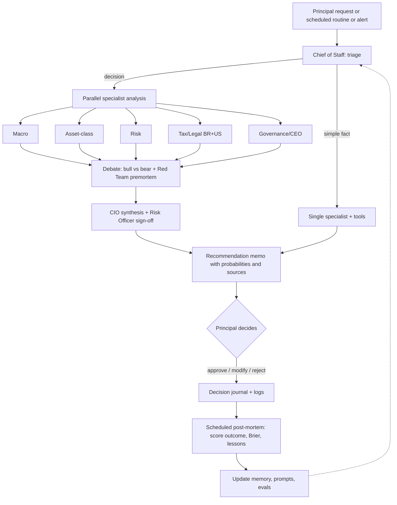

# How the AI Family Office Works

> **Purpose:** Define the operating model, agent patterns, data/memory/tool layers, routines and track-record measurement of the AI Family Office. **Primary users:** the Chief of Staff/Orchestrator agent (workflow owner), the Chief Investment Officer agent, the Red Team agent, the Reporting agent, the Data Librarian agent, and the human developer configuring the system.

## Summary

- Every request follows one pipeline: **request → triage → specialist analysis → debate/red-team → synthesis → recommendation memo → human decision → logging → post-mortem**. The principal always makes the final decision; agents advise and never execute trades on their own.
- The core architecture is an **orchestrator plus specialists**: one coordinating agent splits the work and delegates focused subtasks to expert agents. Anthropic reports this pattern beat a single agent by 90.2% on its internal research evaluation, at roughly 15 times the token cost of a chat [2].
- **Debate and critic agents help, but less than they appear to.** Early work showed debate improves factual accuracy [4]; later studies found debate often fails to beat simpler methods such as asking the same question several times and taking the majority answer [5][6]. Use debate selectively, with genuinely different viewpoints or models [6].
- **LLM trading results in papers are fragile.** Reported advantages shrink under longer, broader backtests [13], and models have memorized historical market data, which inflates backtests run on periods before their training cutoff [14][15]. The system must never treat an LLM backtest as proof of skill.
- **Retrieval (RAG) is mandatory for facts.** On a financial filings benchmark, a model with no documents answered only 11% correctly, and even a retrieval setup failed or refused on 81% of a sample [16]. Every number in a memo must trace to a source document or a tool output.
- Banks deploy LLMs mainly as **retrieval and productivity assistants with strict evaluation gates** (Morgan Stanley, JPMorgan, Goldman Sachs) [18][19][20][21], not as autonomous portfolio managers.
- Every recommendation carries an explicit probability and is logged in a **decision journal**, then scored over time (Brier score) to measure whether the team's confidence is justified [22][23][24].

## Key terms (plain language)

| Term | Meaning |
|---|---|
| **LLM (large language model)** | The AI engine that reads and writes text. It predicts likely text; it does not "know" facts the way a database does. |
| **Agent** | An LLM given a role, instructions, tools, and the ability to take several steps (search, calculate, write) toward a goal. |
| **Orchestrator** | The coordinating agent that breaks a request into subtasks, assigns them to specialist agents ("subagents"), and combines results [1][2]. |
| **Tool use** | The agent calling external functions: a market-data API, a calculator, a spreadsheet, a database query. Results come from the tool, not the model's memory. |
| **Hallucination (confabulation)** | Confident, fluent output that is false. NIST lists it as a core generative-AI risk and recommends verifying sources and citations in outputs [26]. |
| **RAG (retrieval-augmented generation)** | Before answering, the system searches a document collection and hands relevant passages to the model, so answers are grounded in real text and can cite it [17]. |
| **Embeddings** | Numeric "fingerprints" of text meaning, used to find passages about the same idea even when words differ. They power the search step in RAG. |
| **Context window** | The amount of text the model can read at once. Anything outside it is invisible unless retrieved. |
| **Memory** | Information saved between sessions (preferences, past decisions, open positions) and re-loaded when relevant. |
| **Evals (evaluations)** | Repeatable tests that score agent outputs against known-good answers or a rubric, run before and after any change [2][18]. |
| **LLM-as-judge** | Using a separate model call with a rubric to grade another agent's output [2]. |
| **Calibration** | Whether stated confidence matches reality: of all calls made at "70% likely", about 70% should come true. |
| **Look-ahead bias** | A backtest accidentally using information that was not available at the time; for LLMs, this includes facts memorized during training [14][15]. |

## The operating model, step by step

### Flow diagram



ASCII fallback:

```
Request/Routine/Alert
      |
  [Triage: Chief of Staff] --simple--> [1 specialist + tools] ----------+
      | decision                                                       |
  [Specialists in parallel: Macro | Asset class | Risk | Tax/Legal | Gov]|
      |                                                                |
  [Debate + Red Team premortem]                                        |
      |                                                                |
  [CIO synthesis + Risk sign-off] --> [Recommendation memo] <----------+
                                          |
                                 [HUMAN DECISION]
                                          |
                          [Decision journal + audit log]
                                          |
                      [Post-mortem at review date -> lessons -> memory/evals]
```

### Stage details

| Stage | Owner | What happens | Output |
|---|---|---|---|
| 1. Request | Principal, routine, or alert | Question arrives in free text, or a scheduled job fires. | Ticket with ID, timestamp, requester. |
| 2. Triage | Chief of Staff | Classifies type (fact lookup, analysis, decision, monitoring), urgency, jurisdictions (BR/US), and scales effort. Anthropic found agents misjudge effort unless given explicit scaling rules (e.g., simple fact: 1 agent, 3–10 tool calls; complex: many subagents) [2]. | Task plan: which specialists, what each must deliver, deadline, budget. |
| 3. Specialist analysis | Specialists | Each gets a precise brief: objective, output format, allowed tools and sources, boundaries. Vague briefs caused duplicated or misread work in Anthropic's system [2]. Specialists run in parallel. | Structured findings with sources, numbers from tools, confidence. |
| 4. Debate / red team | Bull & bear analysts, Red Team | Opposing cases are argued; the Red Team runs a **premortem**: assume the decision failed a year from now and list why [25]. | Objections list, kill criteria, disagreements that remain. |
| 5. Synthesis | CIO, with Risk Officer sign-off | Weighs evidence, sizes position against policy limits, keeps dissent visible rather than averaging it away. | Draft recommendation. |
| 6. Memo | Reporting agent | Standard template (below). | Recommendation memo. |
| 7. Human decision | Principal | Approve, modify, reject, or request more work. | Decision record. |
| 8. Logging | Data Librarian | Store memo, sources, tool outputs, prompts used, model and data versions. | Immutable journal entry. |
| 9. Post-mortem | Chief of Staff + Red Team | At the pre-set review date, compare outcome with forecast; separate bad luck from bad reasoning. | Score, lessons, changes to prompts/evals. |

### Recommendation memo template (Recommendation)

1. Question and decision required, with deadline.
2. Recommendation in one sentence (action, size, instrument, jurisdiction/account).
3. Thesis: 3–5 drivers, each with a citation or tool output.
4. Probabilities: base, bull, bear scenarios with explicit probabilities and expected return/loss in BRL and USD.
5. Risks and kill criteria (what would make us exit).
6. Dissent: strongest counter-argument and who holds it.
7. Tax, legal and regulatory notes for Brazil and the US.
8. Fit with the Investment Policy Statement (IPS) and current portfolio (concentration, liquidity, currency).
9. Confidence level and what evidence would change it.
10. Review date for the post-mortem.

## Multi-agent patterns and what the evidence says

### Orchestrator plus specialists
Anthropic describes "orchestrator-workers" as a workflow in which a central model dynamically splits a task and synthesizes the workers' results, and recommends starting with the simplest design that works [1]. In its research system, a lead agent with parallel subagents outperformed a single agent by 90.2% on an internal eval; token usage alone explained 80% of performance variance on a browsing benchmark, and multi-agent runs used about 15x the tokens of chat [2]. Anthropic notes the pattern fits poorly when all agents need the same context or depend heavily on each other [2]. The Claude Agent SDK supports this directly: subagents are separate agent instances defined in code or as markdown files, which the main agent spawns for focused subtasks [3].

### Debate
Du et al. had several model instances propose answers and debate over rounds; this improved reasoning and factual accuracy and reduced hallucinations versus single-model baselines [4]. However, Smit et al. found debate "in their current form" does not reliably beat other strategies such as self-consistency (sampling several answers and taking the majority) and ensembling [5]. Zhang et al. reached the same conclusion across many benchmarks, even when debate used more computation, but found that **mixing different models** (heterogeneity) significantly helps [6]. Huang et al. argue that much of the apparent gain from debate is really from consistency across multiple samples, and that models cannot reliably self-correct their reasoning without external feedback [7].

### Critic / red team (evaluator-optimizer)
One model generates, another critiques, in a loop; this works best when evaluation criteria are clear [1]. The critic is most useful when it has external checks (a calculator, a filing, a price feed) rather than its own opinion [7].

### Investment-committee simulation
TradingAgents models a trading firm: fundamental, sentiment and technical analysts; bull and bear researchers who debate; a trader; and a risk-management team. On historical data it reported better cumulative return, Sharpe ratio and drawdown than baselines, with live deployment left to future work [9]. FinMem adds layered memory and an adjustable risk "character" to a trading agent [10]. Both are backtest-only results.

### Why multi-agent systems fail
A Berkeley study of 150+ multi-agent traces identified 14 failure modes in three groups: poor specification/system design, misalignment between agents, and weak verification/termination; gains over single agents on benchmarks were often minimal, and simple prompt fixes did not resolve the failures [8].

**Recommendation:** Use orchestrator plus specialists as the default. Use debate only for material decisions, with a Red Team that has tool access and, where possible, a different model or a different prompt persona [6]. Prefer independent parallel analyses followed by aggregation over long back-and-forth chats. Combine AI and human judgment: in forecasting studies, an ensemble of 12 LLMs matched a crowd of 925 human forecasters, and simply averaging human and machine forecasts was more accurate still [22].

## LLMs in finance: evidence and failure modes

| Example | What it shows | Documented limits |
|---|---|---|
| BloombergGPT (2023) | ~50B-parameter model trained on 363B tokens of financial data plus 345B general tokens; beat similar-size open models on financial tasks [11]. | Domain training is expensive; general-purpose models plus retrieval have since become the common enterprise path (see bank deployments below). **Assumption:** a private office should not train its own model. |
| Lopez-Lira & Tang | LLM headline sentiment predicted next-day returns, strongest in small stocks and bad news; returns decline as LLM adoption rises [12]. | Backtest on headlines; edge decays as markets adopt the tool [12]. |
| TradingAgents, FinMem | Role-based and memory-based trading agents beat baselines in backtests [9][10]. | No live track record [9]. |
| FINSABER (KDD 2026) | Testing over 2000–2024 and 100+ symbols with delisted stocks included: earlier LLM advantages "deteriorate significantly"; LLM strategies were too conservative in bull markets and too aggressive in bear markets [13]. | Shows how survivorship and selection bias inflate published results [13]. |
| Memorization studies | LLMs recall exact economic and financial values from before their training cutoff, so pre-cutoff forecasts cannot be separated from memory [14]; memorization "substantially amplifies" apparent predictive power [15]. | Masking company names does not fully fix it [15]. |
| FinanceBench | Closed-book accuracy 11%; a retrieval setup failed or refused 81% of 150 sampled questions; one model hallucinated more, another refused more [16]. | Retrieval quality is the bottleneck. |
| Morgan Stanley | AI @ Morgan Stanley Assistant gives advisors access to ~100,000 research documents [19]; every use case passes an eval framework (summarization, accuracy, later translation) before deployment; vendor reports 98%+ advisor-team adoption [18]. | Adoption figure is vendor-reported [18]. |
| JPMorgan LLM Suite | Portal to external LLMs; 200,000 users onboarded in about eight months; uses include writing, summarizing, Excel problem solving; next step is agents for multi-step workflows [20]. | Productivity tool, not an investment decision maker. |
| Goldman Sachs GS AI Assistant | Firmwide launch in June 2025 after ~10,000-employee pilot; connects to several approved models, with versions for bankers, research and wealth staff [21]. | Same: assistant, not autonomous. |

**Failure modes the team must design against:** hallucinated numbers and citations [16][26]; look-ahead bias and memorization in backtests [14][15]; overconfidence (models' stated confidence tends to be too high) [23]; regime blindness (wrong behavior in bull vs bear markets) [13]; edge decay as strategies become crowded [12]; multi-agent coordination failures [8]; and herding, where agents built on the same model share the same blind spots [6].

## Retrieval over the principal's documents (RAG)

**Recommendation:** A document library managed by the Data Librarian, containing the IPS, brokerage and bank statements (BR and US), tax returns (Brazilian DIRPF and US filings), entity documents, insurance, research reports, and prior memos.

- **Ingestion:** convert PDFs/spreadsheets to text, tag each chunk with metadata (document date, entity, account, jurisdiction, currency, confidentiality level).
- **Search:** combine embedding search (meaning) with keyword search (exact tickers, CNPJ, CUSIP, account numbers); filter by date to avoid using stale statements.
- **Answering:** the agent must quote or cite the passage it used; if nothing relevant is retrieved, it must say "not found" rather than guess [16][26].
- **Point-in-time discipline:** for any historical analysis, retrieve only documents dated before the decision date, to avoid look-ahead bias [14].
- **Privacy:** **Assumption:** sensitive personal and financial documents stay in storage the principal controls; external web searches never include the principal's identity or holdings.

## Memory

| Layer | Contents | Lifetime |
|---|---|---|
| Working memory | Current task brief, retrieved passages, tool outputs | One task |
| Profile memory | Goals, risk tolerance, IPS limits, tax residency facts, liquidity needs, preferences | Until principal edits |
| Portfolio state | Holdings, cost basis, cash by currency and account | Refreshed from statements/APIs, never from model recall |
| Episodic memory | Decision journal entries, memos, post-mortem lessons | Permanent |
| Knowledge notes | Thesis files per holding, watchlists, CEO profiles | Updated per review |

FinMem ranks memories by recency, relevance and importance and promotes important events to longer-lived layers [10]; this is a reasonable design reference. **Recommendation:** memory writes go through the Data Librarian with a source and date, and the principal can view and delete any memory.

## Tool use

**Recommendation:** Numbers come from tools, never from the model's memory.

| Tool category | Examples | Used by |
|---|---|---|
| Market data | Prices, yields, FX (BRL/USD), curves (DI futures, US Treasuries), index levels | All asset-class agents, Risk |
| Macro data | Central-bank and statistics releases (Brazil and US) | Macro Economist |
| Filings | SEC EDGAR, CVM filings | Equity, Governance, Due Diligence |
| Calculators | Bond math, tax calculators (BR/US), loan/real-estate cash flows, XIRR | Specialists, Tax |
| Portfolio analytics | Exposure by asset/currency/country, VaR, stress tests, scenario P&L, rebalancing | Quant, Risk |
| Code execution | Python sandbox for statistics and charts | Quant, Risk |
| News and web search | Event detection, geopolitical monitoring | Geopolitical, Chief of Staff |

In the Claude Agent SDK, tools can be exposed through the Model Context Protocol (MCP), and Anthropic found that poorly described tools cause agent failures, fixing them by having an agent test and rewrite tool descriptions [2]. Each specialist should get only the tools its role needs [3].

## Recurring routines

| Routine | Timing | Content | Owner |
|---|---|---|---|
| Daily brief | Each business morning (Brasília time) | Overnight markets, BRL/USD, Selic/DI and US rates, portfolio moves beyond thresholds, calendar of data releases and earnings, top 3 geopolitical/political items | Chief of Staff + Macro |
| Weekly portfolio review | Weekly | Performance vs benchmark (in BRL and USD), drift vs IPS targets, concentration, liquidity, open theses status, upcoming decisions | CIO + Quant + Risk |
| Monthly/quarterly | Monthly, quarterly | Full report, tax events (BR monthly capital gains rules, US estimated taxes), rebalancing proposals, calibration scorecard | Reporting + Tax |
| Event-driven alerts | Real time | Price/limit breaches, rating changes, central-bank surprises, regulatory changes, CEO departures, news on holdings | Risk + relevant specialist |
| Post-mortems | At each memo's review date | Outcome vs forecast, lessons | Chief of Staff + Red Team |

**Recommendation:** alerts must have explicit thresholds set in the IPS to avoid alert fatigue.

## Decision journal, calibration and track record

### Decision journal entry (Recommendation)
Date; question; options considered; recommendation; principal's decision and reasoning; probabilities for key outcomes; expected value; key assumptions; kill criteria; information available at the time (snapshot links); dissent; review date; later: outcome, score, lessons.

### Scoring
- **Brier score:** the average squared difference between forecast probability and outcome (1 if it happened, 0 if not). Lower is better; 0 is perfect. A 70% forecast that comes true scores 0.09; if it fails, 0.49 [24].
- **Calibration chart:** group forecasts by stated probability (e.g., 60–70%) and compare with actual hit rate. LLM verbalized confidence tends to be overconfident; sampling several answers and checking consistency calibrates better [23].
- **Investment outcomes:** return vs benchmark and vs "do nothing", risk-adjusted return, maximum drawdown, and hit rate of kill criteria.
- **Process quality:** share of memos with complete sourcing, number of factual errors found by the Red Team or the principal, time to decision.
- **Separate luck from skill:** **Assumption:** with few decisions per year, statistical significance will take years; judge process quality and calibration first, returns later.
- **Benchmark against simple baselines:** compare agent recommendations with a passive allocation and with the principal's own unaided calls, since research shows LLM strategies often fail to beat passive benchmarks over long periods [13].

## Implications for the agent team

- The Chief of Staff must enforce triage and effort budgets; multi-agent runs are costly [2].
- Every specialist output must carry sources and tool outputs; the Red Team rejects unsourced numbers [16][26].
- Debate is reserved for material decisions and uses varied personas or models [5][6].
- No agent may cite an LLM-generated backtest on pre-training-cutoff data as evidence of an edge [13][14][15].
- Evals are built before agents go live, following the Morgan Stanley pattern of testing each use case [18]; use LLM-as-judge plus human spot checks [2].
- The system advises; the principal decides. **Assumption:** advice is for the principal's own account. Regulatory status of AI advice to third parties is out of scope here; note that the SEC withdrew its proposed rule on advisers' use of predictive data analytics in June 2025 [27], so the US rulebook on this point remains unsettled.

## Open questions and assumptions

- Which market-data and filing APIs will be licensed for Brazil (B3, CVM, Tesouro) and the US? Cost and coverage determine tool design.
- Should different specialists run on different model providers to reduce shared blind spots [6]? Trade-off: complexity and data-privacy review.
- Where will the document library and logs be hosted, and with what encryption and access controls?
- What thresholds define a "material decision" that triggers full debate?
- **Assumption:** the principal will record decisions and reasons consistently; without this, post-mortems and calibration cannot work.
- **Assumption:** evidence cited here is mostly preprints and vendor case studies; results may not replicate.

## Sources

1. Building effective agents, Anthropic, 2024, https://www.anthropic.com/engineering/building-effective-agents (accessed 2026-11-27)
2. How we built our multi-agent research system, Anthropic, 2025, https://www.anthropic.com/engineering/multi-agent-research-system (accessed 2026-11-27)
3. Subagents in the SDK, Claude Agent SDK documentation, Anthropic, 2025–2026, https://code.claude.com/docs/en/agent-sdk/subagents (accessed 2026-11-27)
4. Du, Li, Torralba, Tenenbaum, Mordatch, Improving Factuality and Reasoning in Language Models through Multiagent Debate, ICML (PMLR 235), 2024, https://arxiv.org/abs/2305.14325 (accessed 2026-11-27)
5. Smit et al., Should we be going MAD? A Look at Multi-Agent Debate Strategies for LLMs, ICML, 2024, https://arxiv.org/abs/2311.17371 (accessed 2026-11-27)
6. Zhang et al., Stop Overvaluing Multi-Agent Debate: We Must Rethink Evaluation and Embrace Model Heterogeneity, arXiv, 2025, https://arxiv.org/abs/2502.08788 (accessed 2026-11-27)
7. Huang et al., Large Language Models Cannot Self-Correct Reasoning Yet, arXiv/ICLR, 2023–2024, https://arxiv.org/abs/2310.01798 (accessed 2026-11-27)
8. Cemri et al., Why Do Multi-Agent LLM Systems Fail?, UC Berkeley, NeurIPS Datasets and Benchmarks, 2025, https://arxiv.org/abs/2503.13657 (accessed 2026-11-27)
9. Xiao, Sun, Luo, Wang, TradingAgents: Multi-Agents LLM Financial Trading Framework, arXiv, 2024–2025, https://arxiv.org/abs/2412.20138 (accessed 2026-11-27)
10. Yu et al., FinMem: A Performance-Enhanced LLM Trading Agent with Layered Memory and Character Design, arXiv / ICLR workshop, 2023, https://arxiv.org/abs/2311.13743 (accessed 2026-11-27)
11. Wu et al., BloombergGPT: A Large Language Model for Finance, Bloomberg / arXiv, 2023, https://arxiv.org/abs/2303.17564 (accessed 2026-11-27)
12. Lopez-Lira, Tang, Can ChatGPT Forecast Stock Price Movements? Return Predictability and Large Language Models, arXiv working paper, 2023–2025, https://arxiv.org/abs/2304.07619 (accessed 2026-11-27)
13. Li, Kim, Cucuringu, Ma, Can LLM-based Financial Investing Strategies Outperform the Market in Long Run? (FINSABER), arXiv / KDD 2026, 2025, https://arxiv.org/abs/2505.07078 (accessed 2026-11-27)
14. Lopez-Lira, Tang, Zhu, The Memorization Problem: Can We Trust LLMs' Economic Forecasts?, arXiv, 2025, https://arxiv.org/abs/2504.14765 (accessed 2026-11-27)
15. Gao, Jiang, Yan, Detecting Lookahead Bias in LLM Forecasts, arXiv, 2025, https://arxiv.org/abs/2512.23847 (accessed 2026-11-27)
16. Islam et al., FinanceBench: A New Benchmark for Financial Question Answering, Patronus AI / arXiv, 2023, https://arxiv.org/abs/2311.11944 (accessed 2026-11-27)
17. Lewis et al., Retrieval-Augmented Generation for Knowledge-Intensive NLP Tasks, NeurIPS, 2020, https://arxiv.org/abs/2005.11401 (accessed 2026-11-27)
18. Morgan Stanley customer story, OpenAI, n.d. (2023–2024), https://openai.com/index/morgan-stanley/ (accessed 2026-11-27)
19. Morgan Stanley debuts an AI assistant to answer common investing and personal finance queries, Fortune, 2023, https://fortune.com/2023/09/20/morgan-stanley-ai-assistant-answer-investing-personal-finance-queries/ (accessed 2026-11-27)
20. How JPMorganChase democratized employee access to gen AI, American Banker, 2025, https://www.americanbanker.com/news/how-jpmorganchase-democratized-employee-access-to-gen-ai (accessed 2026-11-27)
21. Goldman Sachs launches internal AI assistant firmwide, Fortune, 2025, https://fortune.com/2025/06/24/goldman-sachs-internal-ai-assistant/ (accessed 2026-11-27)
22. Schoenegger, Tuminauskaite, Park, Tetlock, Wisdom of the Silicon Crowd: LLM Ensemble Prediction Capabilities Rival Human Crowd Accuracy, Science Advances (LSE record), 2024, https://researchonline.lse.ac.uk/id/eprint/125626 (accessed 2026-11-27)
23. Xiong et al., Can LLMs Express Their Uncertainty? An Empirical Evaluation of Confidence Elicitation in LLMs, ICLR, 2024, https://arxiv.org/abs/2306.13063 (accessed 2026-11-27)
24. A Brief on Brier Scores (summarizing Brier, Verification of Forecasts Expressed in Terms of Probability, Monthly Weather Review, 1950), University of Virginia Library, https://library.virginia.edu/data/articles/a-brief-on-brier-scores (accessed 2026-11-27)
25. Klein, Performing a Project Premortem, Harvard Business Review, 2007, https://hbr.org/2007/09/performing-a-project-premortem (accessed 2026-11-27)
26. NIST AI 600-1, Artificial Intelligence Risk Management Framework: Generative Artificial Intelligence Profile, NIST, 2024, https://nvlpubs.nist.gov/nistpubs/ai/NIST.AI.600-1.pdf (accessed 2026-11-27)
27. SEC Withdraws Fourteen Rule Proposals, Proskauer, 2025, https://www.proskauer.com/alert/sec-withdraws-fourteen-rule-proposals (accessed 2026-11-27)
